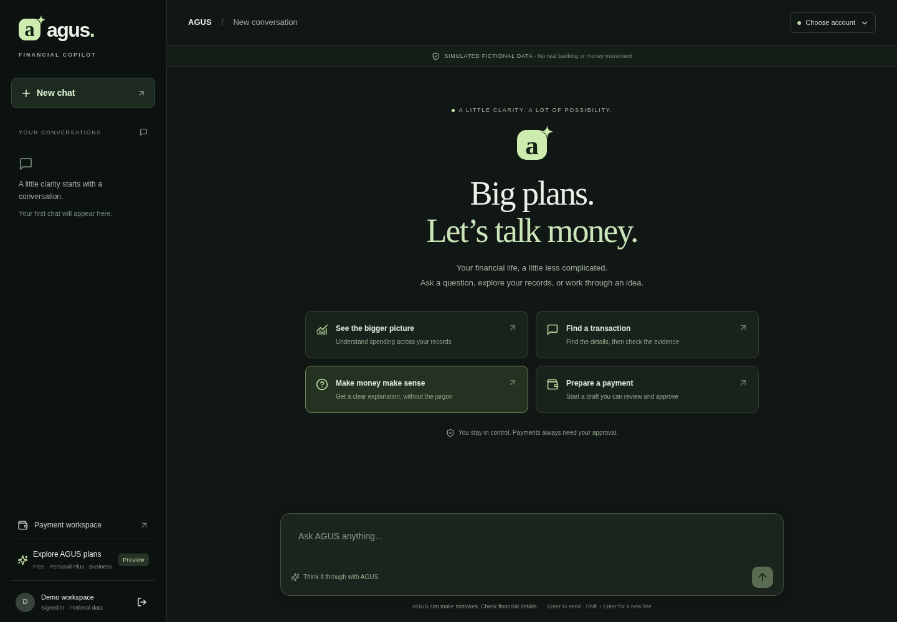
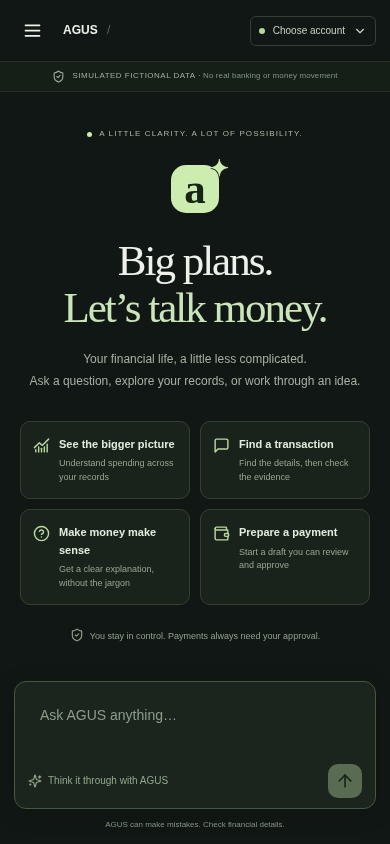

# AGUS conversational product experience

Candidate starts exactly at PR #23 (`fix/financial-education-rejections`), commit `d4e0e5863b466e01250742332bd7cc48e68d3dbc`. Work is isolated on `feat/agus-conversational-workspace` in `/workspace/agus-conversation`. Existing PR branches are unchanged. No merge, deployment, real banking, billing or credential setup is included.

## Product behavior

`/conversation` now provides a dark green AGUS workspace with a responsive welcome, suggested prompts, a persistent chat sidebar, direct sign-in through the existing session endpoint, optional authorized account selection, a keyboard-accessible composer, pending replies and recoverable errors. Enter sends; Shift+Enter inserts a line; IME composition does not send. Native dialogs support Escape and return focus to their trigger. A skip link reaches the composer, responses use a polite log, and reduced motion is respected.

Financial cards format literal server-rendered amounts without client calculations. Candidate records, clarification choices, complete response text, source metadata and evidence references remain visible. Every screen retains the fictional-data disclosure. Choosing a clarification fills the composer for the user to review. The existing payment handoff passes the request to `/api/chat` only after an explicit click and then opens the payment workspace; verification, password approval and explicit execution remain there.

Free, Personal Plus and Business are proposed tiers in a clearly labelled plan preview. There is no usage counter, invented quota, subscription, activation, price or billing.

## Persistence and ownership

- `chat_history` and `chat_turns` are SQL tables using the existing database connection: PostgreSQL when configured, otherwise disk-backed PGlite. They initialize on first use, following the repository's existing storage convention. The same database must be retained across service restarts.
- Every primary key, foreign key and query includes the authenticated operator ID. The server derives it from the HttpOnly session; request parameters cannot select an owner. Identical conversation IDs under different owners have separate titles and transcripts. The history API rejects unsupported query parameters and foreign/malformed IDs and sends private, no-store responses.
- `GET /api/conversations` lists the owner's chats; `GET /api/conversations?id=…` loads a complete transcript. `POST /api/conversation` records the server-generated reply before returning it, including provider-unavailable replies. New chats appear after their first request; titles derive deterministically from the first message. No client endpoint accepts transcript bodies.
- A 90-second SQL lease serializes turns in a chat and allows recovery after an interrupted request. A replaced lease cannot write a stale reply. The existing agent still enforces its own context CAS and access rechecks.
- Transcripts have no 15-minute expiry. Their display content is never supplied as financial authority or reconstructed into permission context. The existing `fm_context` retains its separate 15-minute expiry, bounded model context, selection checks and permission/revision validation. An expired context row can now be atomically replaced with fresh revision 1; an unexpired collision still fails CAS.
- Account selection is not persisted and clears on reload, chat switching and New Chat. A saved response is a historical snapshot; personal follow-ups require choosing a currently authorized account. Sign-out or a 401 clears visible transcript, accounts and chat list. Late authenticated list/account responses are discarded after that boundary.
- Browser storage does not hold transcripts, accounts or chat IDs. The URL holds only an opaque active chat ID, so reload can request the transcript from the server.
- User text and titles use the existing scrubber before storage: credential patterns, long numbers and URLs are withheld. This also means a restored payment request may need details re-entered in its editable draft. Do not enter real banking credentials in the demo.

## Validation

- `npm run lint`: PASS.
- `npm run typecheck`: PASS.
- `npm run build`: PASS, optimized production build.
- Focused Vitest: **254 passed / 6 files** — chat history, integrated conversation, agent security, routing, education and payments. Includes owner isolation, unauthorized/injected reads, process restart, stale leases, provider failure persistence, context expiry/renewal and current permission enforcement.
- `npm run test:browser:workspace`: PASS against the production build at **1440×1000, 820×1000, 390×844 and 320×740**. Checks welcome, session sign-in, server history/reload, New Chat, switching, general conversation and education, exact financial totals, source attribution, clarification controls, plan preview, retained input after network failure, payment draft handoff, sign-out, keyboard send/multiline, dialog Escape/focus restoration, delayed-response sign-out isolation, no horizontal overflow and visible composer. No page errors. No payment approval or execution requests occur.
- Browser inference uses an explicit test-only mocked Gemini transport. Calculations, fixture records, permissions, SQL persistence, sessions, HTTP routes and the payment handoff use the real application code. No genuine model API or real banking calls were made. The model adapter, financial-data engine, calculations and payment safeguards are unchanged.
- `git diff --check`: PASS. No expensive full-suite repetition.

Reproduce with `npm ci`, `npm run build`, the focused Vitest command below, then `npm run test:browser:workspace`. The browser script creates temporary fixture credentials/database and removes them when it exits; it uses `/usr/bin/chromium` unless `CHROMIUM_PATH` is set. `WORKSPACE_SCREENSHOT_DIR` can redirect evidence.

```sh
npx vitest run tests/financial-integration/chat-history.test.ts tests/financial-integration/conversation.test.ts tests/financial-agent/security.test.ts tests/financial-agent/routing.test.ts tests/financial-agent/education.test.ts tests/payments.test.ts
```

## Browser evidence

Machine-readable results: [browser-results.json](browser-results.json). Each width includes welcome, financial result, transaction matches and plan preview screenshots.

| Width        | Welcome                  | Financial result           | Matches                  | Plans                  |
| ------------ | ------------------------ | -------------------------- | ------------------------ | ---------------------- |
| Desktop 1440 | [View](welcome-1440.png) | [View](financial-1440.png) | [View](matches-1440.png) | [View](plans-1440.png) |
| Tablet 820   | [View](welcome-820.png)  | [View](financial-820.png)  | [View](matches-820.png)  | [View](plans-820.png)  |
| Mobile 390   | [View](welcome-390.png)  | [View](financial-390.png)  | [View](matches-390.png)  | [View](plans-390.png)  |
| Mobile 320   | [View](welcome-320.png)  | [View](financial-320.png)  | [View](matches-320.png)  | [View](plans-320.png)  |





## Changed files

- `src/components/financial-conversation.tsx` and `financial-conversation.css`: workspace, responsive styling, result presentation, account controls, history, sign-in and plan preview.
- `src/lib/chat-history/store.ts`: server-only SQL history and request leases.
- `src/app/api/conversations/route.ts`: authenticated history reads.
- `src/app/api/conversation/route.ts`: persist completed conversation turns.
- `src/lib/financial-integration/context-persistence.ts`: expired context replacement while retaining CAS.
- `tests/financial-integration/chat-history.test.ts` and `chat-history-worker.ts`: ownership, HTTP, restart, concurrency and expiry checks.
- `scripts/browser-workspace.mjs`, `scripts/fixtures/gemini-workspace.mjs` and `package.json`: production browser verification and test-only transport.
- `docs/conversation-experience/`: report, browser results and 16 screenshots.

## Remaining limits

Authentication remains the repository's existing single configured operator login. People sharing that operator identity share its saved chats; this change does not add individual signup or a new identity provider. The SQL history interface is owner-scoped for distinct authenticated identities, as verified in isolation tests.

Visible transcripts persist; long-term model memory does not. Context expires after 15 minutes and must be rebuilt from fresh authorized reads. A request interrupted before its reply is committed may need repeating. There is no chat deletion, search, pagination or retention-management UI in this pitch scope. Plans are a preview and model behavior was browser-tested with mocked inference, not a genuine Gemini session.
